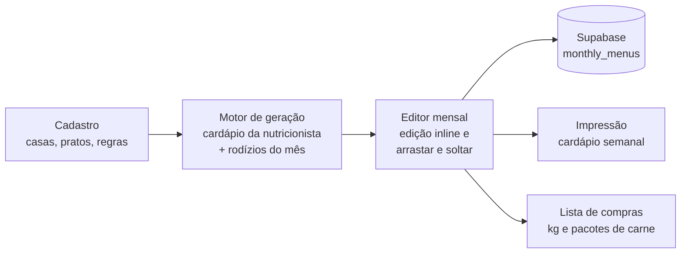

# Smart Menu — cardápios mensais para casas de repouso

Aplicação web que gera, edita e imprime o cardápio do mês de três casas de repouso e calcula a lista de compras de carnes. Esta é a **v1, single tenant na prática**: feita sob medida para minha sogra, que cuida dos cardápios das casas, antes da decisão de transformar o projeto em SaaS.

> **Status:** v1 em uso real desde ago/2026 · 17 commits · ~5.600 linhas de TypeScript · a v2 multi-tenant no ar em cardapiomagico.com.br

## O problema

Todo mês o cardápio era montado à mão no Word, a partir dos documentos da nutricionista: seis refeições por dia, versões para **diabéticos** e para **dieta pastosa**, um arquivo por casa e a conta de quantos quilos de cada carne comprar. Era trabalho repetitivo, demorado e fácil de errar (dias trocados, prato repetido, compra errada).

## O que a v1 faz

- **Gera o mês inteiro em um clique**, seguindo o cardápio fixo da nutricionista e as regras de rodízio (frutas, sucos, sopas, mingaus e mousse aos domingos).
- **Versões clínicas no mesmo dia:** café, almoço, lanche, jantar e ceia para diabéticos e para dieta pastosa.
- **Editor visual do mês:** edição direto na célula, arrastar e soltar pratos entre dias e itens extras opcionais por refeição.
- **Impressão pronta**, no layout semanal que as casas já usavam, com a logo de cada casa (sem botões nem ícones no papel).
- **Lista de compras de carnes:** identifica a carne de cada prato principal, soma os quilos do mês e converte em pacotes de entrega.
- **Cadastro por casa** de pratos e regras do cardápio, com dados salvos no Supabase.

## Como funciona



| Parte | Arquivo | O que faz |
|---|---|---|
| Motor de geração | [`src/lib/menuGenerator.ts`](src/lib/menuGenerator.ts) | Monta os 28–31 dias do mês combinando o cardápio da nutricionista com os pratos cadastrados |
| Regras do cardápio | [`src/lib/menuRules.ts`](src/lib/menuRules.ts) | Ciclos de 31 dias e as variações para diabéticos e pastosos |
| Lista de compras | [`src/lib/shoppingList.ts`](src/lib/shoppingList.ts) | Classifica a carne de cada prato e calcula kg e pacotes |
| Editor | [`src/app/dashboard/menu/[tenantSlug]/[yearMonth]/page.tsx`](src/app/dashboard/menu/) | Grade do mês, edição, salvar, imprimir |
| Banco | [`supabase/migrations/`](supabase/migrations/) | Schema, dados iniciais e correções |

## Stack

Next.js 16 · React 19 · TypeScript · Tailwind CSS 4 · Supabase (Postgres) · date-fns · GitHub Actions. Construído com vibe coding, usando IA para acelerar o desenvolvimento.

## Decisões e aprendizados

- **Fidelidade antes de criatividade.** A primeira versão sorteava pratos; a usuária precisava do cardápio exato da nutricionista. A regra virou: cardápio fixo primeiro, rodízio só onde a nutricionista não definiu.
- **Bug em produção que ensinou sobre migrations.** O botão Salvar apagava o mês e não gravava o novo: a coluna `meal_data` nunca tinha sido criada em produção, porque a migration inicial usa `CREATE TABLE IF NOT EXISTS`. Corrigi com uma migration idempotente ([`002_add_meal_data_column.sql`](supabase/migrations/002_add_meal_data_column.sql)) e passei a mostrar o erro na tela em vez de falhar em silêncio.
- **Feedback semanal da usuária guiou o roadmap:** itens extras por refeição, arrastar itens extras entre linhas e a lista de compras nasceram de pedidos dela.
- **Plano gratuito do Supabase pausa por inatividade**, então uma rota `/api/keep-alive` é chamada a cada 3 dias por um GitHub Action.

## Limites da v1 (e por que vai virar SaaS)

A v1 resolve bem o problema de uma pessoa, mas não serve para vender:

| Limite da v1 | Como fica na v2 SaaS |
|---|---|
| Sem login; políticas do Supabase liberam leitura e escrita para qualquer um com a chave pública | Autenticação e RLS por organização |
| Cardápios da nutricionista escritos no código | Cardápio-base como dado, importado de .docx/PDF ou cadastrado na tela |
| Casas, logos e cores fixas na migration | Cadastro self-service de casas e marcas |
| Salvar apaga e regrava o mês (dois passos, sem transação) | Upsert por dia ou função transacional no Postgres |
| Carne identificada por palavras no nome do prato | Ingredientes estruturados por prato, com quantidade por pessoa |

## Como rodar

```bash
git clone https://github.com/Uugaren/SmartMenu.git
cd SmartMenu
npm install
```

1. Crie um projeto no Supabase e rode os arquivos de `supabase/migrations/` em ordem no SQL Editor.
2. Crie `.env.local` com as chaves do projeto:

   ```bash
   NEXT_PUBLIC_SUPABASE_URL=https://seu-projeto.supabase.co
   NEXT_PUBLIC_SUPABASE_ANON_KEY=sua-chave-anon
   ```

3. Rode `npm run dev` e abra [http://localhost:3000](http://localhost:3000).
4. Opcional: para o keep-alive, cadastre o secret `APP_URL` no GitHub com a URL de produção.

## Autor

Arthur Alves Rocha · Ciência da Computação (UVV) · [jarentech.com.br](https://jarentech.com.br) · [LinkedIn](https://www.linkedin.com/in/arthur-alves-rocha-651b162b1/)
